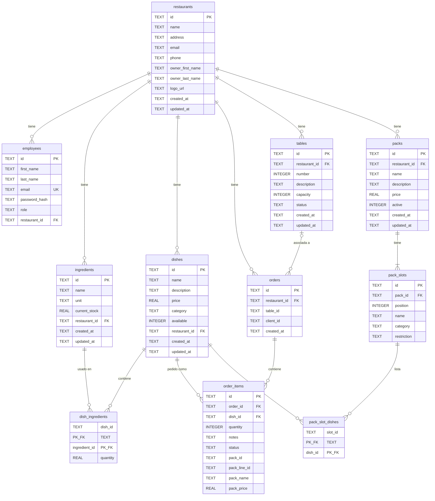

# Modelo de Datos

Esquema de la base de datos SQLite de Resttek.

---

## Diagrama Entidad-Relación

---

## Tablas

### `restaurants`

Almacena la información de los restaurantes.

| Columna | Tipo | Nullable | Descripción |
| --- | --- | --- | --- |
| `id` | TEXT | No | UUID, clave primaria |
| `name` | TEXT | No | Nombre del restaurante |
| `address` | TEXT | No | Dirección |
| `email` | TEXT | No | Email de contacto |
| `phone` | TEXT | No | Teléfono |
| `owner_first_name` | TEXT | No | Nombre del propietario |
| `owner_last_name` | TEXT | No | Apellido del propietario |
| `logo_url` | TEXT | Sí | URL del logo |
| `created_at` | TEXT | No | Fecha de creación (ISO 8601) |
| `updated_at` | TEXT | No | Fecha de última actualización |

---

### `employees`

Almacena **todos** los usuarios del sistema, incluidos los clientes: no hay tabla de clientes aparte. Un cliente es una fila con `role = 'cliente'` y `restaurant_id` a null.

| Columna | Tipo | Nullable | Descripción |
| --- | --- | --- | --- |
| `id` | TEXT | No | UUID, clave primaria |
| `first_name` | TEXT | No | Nombre |
| `last_name` | TEXT | No | Apellido |
| `email` | TEXT | No | Email (único) |
| `password_hash` | TEXT | No | Hash bcrypt de la contraseña |
| `role` | TEXT | No | Rol: admin, manager, camarero, cocinero, cliente |
| `restaurant_id` | TEXT | Sí | FK → `restaurants.id` (null para admin y cliente) |

**Restricciones:**

- `email` es UNIQUE.
- `restaurant_id` es FK a `restaurants.id`.

---

### `ingredients`

Ingredientes disponibles en cada restaurante.

| Columna | Tipo | Nullable | Descripción |
| --- | --- | --- | --- |
| `id` | TEXT | No | UUID, clave primaria |
| `name` | TEXT | No | Nombre del ingrediente |
| `unit` | TEXT | No | Unidad: kg, g, l, ml, unidad |
| `current_stock` | REAL | No | Stock actual (default: 0) |
| `restaurant_id` | TEXT | No | FK → `restaurants.id` |
| `created_at` | TEXT | No | Fecha de creación |
| `updated_at` | TEXT | No | Fecha de última actualización |

---

### `dishes`

Platos de la carta de cada restaurante.

| Columna | Tipo | Nullable | Descripción |
| --- | --- | --- | --- |
| `id` | TEXT | No | UUID, clave primaria |
| `name` | TEXT | No | Nombre del plato |
| `description` | TEXT | Sí | Descripción |
| `price` | REAL | No | Precio en euros |
| `category` | TEXT | No | Categoría: entrante, principal, postre, bebida |
| `available` | INTEGER | No | Disponibilidad: 1 = sí, 0 = no (default: 1) |
| `restaurant_id` | TEXT | No | FK → `restaurants.id` |
| `created_at` | TEXT | No | Fecha de creación |
| `updated_at` | TEXT | No | Fecha de última actualización |

---

### `dish_ingredients`

Relación muchos-a-muchos entre platos e ingredientes.

| Columna | Tipo | Nullable | Descripción |
| --- | --- | --- | --- |
| `dish_id` | TEXT | No | FK → `dishes.id` (PK compuesta) |
| `ingredient_id` | TEXT | No | FK → `ingredients.id` (PK compuesta) |
| `quantity` | REAL | No | Cantidad del ingrediente necesaria |

**Restricciones:**

- PK compuesta: (`dish_id`, `ingredient_id`).
- FK a `dishes.id` **con** `ON DELETE CASCADE`: al borrar un plato desaparecen sus ingredientes asociados.
- FK a `ingredients.id` **sin** cascada.

---

### `tables`

Mesas de cada restaurante.

| Columna | Tipo | Nullable | Descripción |
| --- | --- | --- | --- |
| `id` | TEXT | No | UUID, clave primaria (el seed usa IDs fijos: `rest-1-mesa-1`…) |
| `restaurant_id` | TEXT | No | FK → `restaurants.id` |
| `number` | INTEGER | No | Número visible de la mesa (≥ 1) |
| `description` | TEXT | Sí | Descripción (ej: "Terraza") |
| `capacity` | INTEGER | No | Número máximo de comensales (≥ 1) |
| `status` | TEXT | No | Estado: libre, ocupada, reservada (default: libre) |
| `created_at` | TEXT | No | Fecha de creación |
| `updated_at` | TEXT | No | Fecha de última actualización |

**Restricciones:**

- UNIQUE (`restaurant_id`, `number`): el número de mesa no se repite dentro de un restaurante.
- `restaurant_id` es FK a `restaurants.id`.

---

### `orders`

Pedidos de los clientes.

| Columna | Tipo | Nullable | Descripción |
| --- | --- | --- | --- |
| `id` | TEXT | No | UUID, clave primaria |
| `restaurant_id` | TEXT | No | FK → `restaurants.id` |
| `table_id` | TEXT | Sí | ID de la mesa (`tables.id`, opcional). **Sin FK**: la integridad la valida `OrderService` al crear el pedido |
| `client_id` | TEXT | Sí | ID del cliente (opcional) |
| `created_at` | TEXT | No | Fecha de creación |

---

### `order_items`

Líneas de pedido. Cada ítem es un plato con cantidad y estado.

| Columna | Tipo | Nullable | Descripción |
| --- | --- | --- | --- |
| `id` | TEXT | No | UUID, clave primaria |
| `order_id` | TEXT | No | FK → `orders.id` |
| `dish_id` | TEXT | No | FK → `dishes.id` |
| `quantity` | INTEGER | No | Cantidad pedida |
| `notes` | TEXT | Sí | Notas del cliente (ej: "sin gluten") |
| `status` | TEXT | No | Estado: pendiente, preparando, listo, entregado |
| `pack_id` | TEXT | Sí | ID del pack si el plato se pidió dentro de uno. **Sin FK**: el pack se puede borrar sin tocar los pedidos |
| `pack_line_id` | TEXT | Sí | UUID que comparten los platos de una misma unidad de pack |
| `pack_name` | TEXT | Sí | Copia del nombre del pack al pedir |
| `pack_price` | REAL | Sí | Copia del precio del pack al pedir |

**Restricciones:**

- ON DELETE CASCADE desde `orders.id`.

**Packs en un pedido:** un pack pedido se guarda como una fila por plato elegido (cantidad 1 y su propio estado), así cocina y barra los tratan como cualquier otro plato. Todas las filas de esa unidad de pack comparten `pack_line_id` y llevan la copia de `pack_name` y `pack_price`. En un plato suelto las cuatro columnas son null. El importe se calcula con `calculateOrderItemsTotal()` (`models/order.model.ts`): un plato suelto suma `dishPrice × quantity` y cada `pack_line_id` suma `pack_price` una sola vez, sin contar el precio de sus platos.

Las cuatro columnas de pack se añaden con `ALTER TABLE ... ADD COLUMN` si faltan (ver Notas técnicas).

---

### `packs`

Packs (menús) de precio fijo: el cliente elige un plato en cada hueco.

| Columna | Tipo | Nullable | Descripción |
| --- | --- | --- | --- |
| `id` | TEXT | No | UUID, clave primaria (el seed usa `rest-1-pack-menu-dia` y `rest-2-pack-pizza-bebida`) |
| `restaurant_id` | TEXT | No | FK → `restaurants.id` |
| `name` | TEXT | No | Nombre del pack (ej: "Menú del día") |
| `description` | TEXT | Sí | Descripción |
| `price` | REAL | No | Precio del pack en euros (> 0) |
| `active` | INTEGER | No | 1 = se muestra y se puede pedir, 0 = oculto (default: 1) |
| `created_at` | TEXT | No | Fecha de creación |
| `updated_at` | TEXT | No | Fecha de última actualización |

---

### `pack_slots`

Huecos de un pack, en orden. Cada hueco es una categoría de plato.

| Columna | Tipo | Nullable | Descripción |
| --- | --- | --- | --- |
| `id` | TEXT | No | UUID, clave primaria (se regeneran al editar el pack) |
| `pack_id` | TEXT | No | FK → `packs.id` |
| `position` | INTEGER | No | Orden del hueco dentro del pack (desde 0) |
| `name` | TEXT | No | Nombre visible (ej: "Bebida"); por defecto, la categoría |
| `category` | TEXT | No | Categoría de plato: entrante, principal, postre, bebida |
| `restriction` | TEXT | No | `bloquear` (todos los platos de la categoría menos los listados) o `permitir` (solo los listados). Default: `bloquear` |

**Restricciones:**

- FK a `packs.id` con `ON DELETE CASCADE`.

---

### `pack_slot_dishes`

Platos listados en un hueco: bloqueados o permitidos según `pack_slots.restriction`.

| Columna | Tipo | Nullable | Descripción |
| --- | --- | --- | --- |
| `slot_id` | TEXT | No | FK → `pack_slots.id` (PK compuesta) |
| `dish_id` | TEXT | No | FK → `dishes.id` (PK compuesta) |

**Restricciones:**

- FK a `pack_slots.id` y a `dishes.id`, ambas con `ON DELETE CASCADE`: al borrar un plato desaparece de las listas de los packs.
- Un plato solo se puede elegir en un hueco si es de su categoría, está disponible (`available = 1`) y la lista no lo excluye (`isDishAllowedInSlot()` en `models/pack.model.ts`).

---

## Relaciones

| Relación | Tipo | Descripción |
| --- | --- | --- |
| Restaurant → Employees | 1:N | Un restaurante tiene muchos empleados |
| Restaurant → Ingredients | 1:N | Un restaurante tiene muchos ingredientes |
| Restaurant → Dishes | 1:N | Un restaurante tiene muchos platos |
| Restaurant → Orders | 1:N | Un restaurante tiene muchos pedidos |
| Restaurant → Tables | 1:N | Un restaurante tiene muchas mesas |
| Table → Orders | 1:N | Una mesa puede tener varios pedidos (por `orders.table_id`, sin FK) |
| Dish ↔ Ingredient | N:M | Un plato usa varios ingredientes (via `dish_ingredients`) |
| Order → OrderItems | 1:N | Un pedido tiene varios ítems |
| Dish → OrderItems | 1:N | Un plato puede estar en varios ítems de pedido |
| Restaurant → Packs | 1:N | Un restaurante tiene muchos packs |
| Pack → PackSlots | 1:N | Un pack tiene uno o más huecos ordenados |
| PackSlot ↔ Dish | N:M | Platos bloqueados o permitidos en un hueco (via `pack_slot_dishes`) |

---

## Notas Técnicas

- **IDs**: Todos son UUID v4 generados con `crypto.randomUUID()`. Excepción: el script de seed usa los identificadores fijos `rest-1` y `rest-2` para los restaurantes de prueba, y `rest-1-mesa-1`…`rest-1-mesa-6` y `rest-2-mesa-1`…`rest-2-mesa-4` para sus mesas.
- **Fechas**: Almacenadas como TEXT en formato ISO 8601 (`new Date().toISOString()`).
- **Booleanos**: SQLite no tiene tipo BOOLEAN; se usa INTEGER (0 = false, 1 = true).
- **Nomenclatura**: las columnas son `snake_case` y las propiedades TypeScript `camelCase`. La conversión se hace con alias en el propio SQL (`owner_first_name as ownerFirstName`).
- **Migraciones**: Las tablas se crean automáticamente en `Database.initialize()` con `CREATE TABLE IF NOT EXISTS`.
- **Sin migrations framework**: No se usa un sistema de migraciones formal. Los cambios de esquema se hacen modificando `runInitialMigrations()`. `CREATE TABLE IF NOT EXISTS` no altera una tabla ya creada, así que las columnas nuevas de tablas existentes se añaden después con `addColumnIfMissing(tabla, columna, definición)`, que consulta `PRAGMA table_info` y solo ejecuta `ALTER TABLE ... ADD COLUMN` si falta (es idempotente). Así se añadieron las columnas de pack de `order_items`. Una tabla nueva (como `tables` o `packs`) se crea al arrancar sobre una base de datos existente.
- **Seed**: el seed vacía antes todas las tablas en orden hijo → padre (`TABLES_TO_CLEAR` en `src/scripts/seed.ts`); una tabla nueva hay que añadirla ahí.
- **`orders.table_id` sin FK**: SQLite no permite añadir una FK con `ALTER TABLE`, y `CREATE TABLE IF NOT EXISTS` no modifica tablas existentes. Los pedidos antiguos con un `table_id` que no es una mesa (p. ej. `'5'`) devuelven `tableNumber: null`.